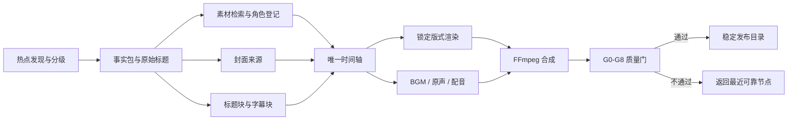

<div align="center">

# News-Editor

### 为支付宝「手机通讯生活号」制作资讯快讯短视频的 Skill

按账号实测的题材优先级筛选热点、核验事实、下载可追溯素材，套用锁定的“标题块＋实拍带＋滑入字幕”版式，以 BGM＋字幕产出 9–15 秒竖屏成片，验收后发布。

[](VERSION)


[快速开始](#快速开始) · [功能](#核心功能) · [架构](#工作架构) · [对标成片](#对标成片) · [质量标准](#质量标准) · [文档](#文档导航)

</div>

## 简介

News-Editor 是一个面向 Codex 与兼容 Agent 平台的新闻短视频生产 Skill。它把“搜热点—找素材—写文案—剪辑—验收”收敛为一套有来源、有时间轴、有预览证据、可以继续修改的制作系统。

2.0 版依据账号四条高播放成片逐帧实测重做：这类成片的共同点是 **9–13 秒、BGM 加字幕而不配音、顶部 2–3 行混排标题块、中段真实素材、黄色黑边字幕跟阅读节奏逐块滑入**。News-Editor 用确定性脚本复现这套版式，并要求机器检查和人工视觉/听觉复核同时通过后才允许发布。

它不生成新闻画面：成片主体始终是真实、可追溯的素材；资料画面必须带免责小字，当事方原话可以保留源字幕与原声。


适合：

- 人物故事、社会民生、手机数码风险、消费维权、放假办理等资讯快讯；
- 没有素材但信息成立的政策更新、时间表、清单（纯图文形态）；
- 已有视频、文案或参考样式的二次剪辑；
- 多主题批量生产与子智能体协作。

## 核心功能

- **选题分级**：先过红线（无信源、改写度不足、时间错位不发），再按 S/A/B 分级，同级按账号实测的题材优先级排序。
- **事实核验**：双来源交叉核验、四类时间留证、跨日台账占位，同事件无新增事实不重做。
- **素材链路**：抖音原始标题精准检索与下载恢复手册；片段分为事件现场、资料画面、当事方原话三种角色。
- **锁定版式**：标题块、实拍带、字幕块与纯图文版的坐标、字号、颜色、倾斜和滑入帧数全部写入锁定 JSON，渲染器按真实字形宽度自适应字号。
- **三种音频模式**：默认 BGM＋字幕；当事方原声＋BGM；用户要求时的 MiniMax 配音＋BGM。
- **封面**：沿用青色大字＋白色副标题＋四角框样式，独立高清图片优先，也可用原片清晰关键帧，统一过四项人工门与几何门。
- **逐帧验收**：最终 MP4 的帧数、时长、响度、真峰值机器实测；分板脚本拆出封面、标题区、实拍区、字幕区供人工逐张检查。
- **平台发布与复盘**：验收后按明确指令发布到支付宝内容创作平台，并按统一观察窗口复盘后台数据。

## 工作架构



News-Editor 将事实、素材、时间轴、声音和验收证据分开保存。任何环节失败都从最近可靠节点恢复，不从头盲目重跑，也不允许用占位画面、无关素材或虚构事实补齐。

### 分层设计

```text
News-Editor
├─ SKILL.md                 # 入口、路由和不可违背的生产约束
├─ config.json              # 版本、画布、声音、节奏、选题分级、版式与封面的唯一机器事实源
├─ references/              # 按任务加载的选题、剪辑、封面、声音和验收规范
├─ scripts/                 # 版本门、时间轴契约、渲染、混音、合成、校验、分板与冒烟测试
├─ assets/
│  ├─ audio/                # 内置新闻 BGM
│  └─ references/           # 锁定版式、封面资产、平台遮挡与版式参考图
├─ agents/openai.yaml       # Skill 展示名称与调用提示
└─ hooks/pre-commit         # 发布前一致性与回归门禁
```

### 单主题与批量模式

- 单主题任务由一个 Agent 按节点完成，适合定向修改和小批量制作。
- 多主题先按事件与事实占位，以 config 在制上限小批滚动；每条开工前刷新候选，N 条是上限而非凑数目标。
- 根 Agent 集中完成文案、时间轴、声音与渲染，素材/封面确有独立工作时才派侦察；时间轴单一写入，最终由独立 QA 只读验收。
- 子智能体只回传结构化交接包和关键决定，长日志、截图和媒体证据留在工作区，减少上下文占用。

## 对标成片

版式来自账号自己已发布的四条高播放成片。四条原件及其截帧含有第三方画面，自 2.0.4 起不再随仓库分发；逐帧实测得到的坐标、字号、颜色和节奏已全部写入 `config.json` 与锁定 JSON。

| 对标成片 | 题型 | 成片形态 | 音频 |
|---|---|---|---|
| 12306 更新 | 民生政策时间表 | 纯图文：蓝色背景＋面板＋逐行正文 | BGM |
| 未婚情侣同居生子分手索款 | 情感纠纷＋判决 | 三行标题块＋红字结果行＋资料画面＋免责小字 | BGM |
| 非洲婚礼父亲送比亚迪当嫁妆 | 国际暖闻＋国产品牌 | 两行标题块＋现场素材＋评论截图浮层 | BGM |
| 花坛藏尸案一审宣判 | 社会案件 | 白字首行＋黄底行标题块，保留源字幕 | 当事方原声＋BGM |

`assets/references/v3-reference/` 里的三张版式参考图由 `scripts/build_layout_reference.py` 用合成素材和示例文案渲染，分别对应上表第一、二、四行的形态。`scripts/smoke_test_brief_pipeline.py` 同样用合成素材重跑整条编码链，不依赖任何下载或样片文件。

## 标准制作流程

1. **版本锁定**：每个新请求先实时核对 GitHub `main`，更新后重新加载 Skill。
2. **选题与事实**：红线→分级→题材排序；核事件/素材/发布/进展时间，双来源核验并在跨日台账占位。
3. **素材获取**：以原始标题精准检索，登记片段角色；封面来源（独立图片优先，其次原片清晰关键帧）同步探针。
4. **素材体检**：生成接触表与实拍带目标裁切预览，登记可用时间码、字幕区、主体和误导风险。
5. **文案与时间轴**：标题块、结果行、3–4 个字幕块；按阅读下限（配音时按实测音长）排块，镜头硬切。
6. **渲染与混音**：锁定版式渲染；BGM、原声或配音按模式混音，再统一合成。
7. **逐帧 QA**：检查封面、第 1 帧、每个字幕块到达帧与滑入帧、切点前后、末帧、声音和平台叠层。
8. **稳定交付**：编辑记录绑定当前文件且 G0–G8 全部通过才标记 FINAL_READY，输出区只保留最终视频和封面。
9. **平台发布**：用户验收及明确授权后核账号、就绪、封面与作者声明，成功记录平台作品 ID 和真实发布时间。
10. **效果复盘**：按真实发布与观察时刻关联后台记录，比较中位浏览、留存、收藏分享和关注。

## 质量标准

| 检查对象 | 必须通过 |
|---|---|
| 事实 | 核心事实双来源；数字、条件、时间与主体一致；推断不冒充事实；时间没有错位 |
| 视频素材 | 来源可追溯；主播和 AI 主播为零；人脸近景受限；资料画面带免责小字 |
| 画面 | 1080×1920、30fps；实拍带等比满幅，其余为素材模糊副本；无大块黑边、跳帧或未许可的源文字 |
| 封面 | 独立高清图片或原片清晰关键帧；无字幕、水印、马赛克和模糊；四项人工编辑门全部通过 |
| 正文 | 标题块 2–3 行且末行黄色斜体；字幕块不超过 4 行与锁定宽度；平台 UI 不遮挡到不可读 |
| 节奏 | 每个字幕块不低于阅读下限；总时长 9–13 秒，不重复或慢放凑时长 |
| 声音 | 音频模式与时间轴一致；最终响度、真峰值、采样率和声道以编码后的 MP4 实测 |
| 交付 | 视频文件名与完整封面标题（主标题，副标题）一致；新闻来源只出现在右下角小字；发布目录没有草稿、脚本和历史版本 |

机器检查用于验证几何、帧数、时长、响度和文件契约；封面审美、素材身份、字幕残留、切点观感、内容匹配和发音仍必须实际观看或试听。

## 快速开始

### 1. 安装

克隆到当前 Agent 平台实际扫描的 Skills 目录。一个平台只保留一个发现入口。

Codex 用户级目录：

```powershell
$skillRoot = Join-Path $env:USERPROFILE '.codex\skills\news-editor'
git clone https://github.com/15972706120-coder/news-editor-skill.git $skillRoot
```

兼容 Agent 的通用目录：

```powershell
$skillRoot = Join-Path $env:USERPROFILE '.agents\skills\news-editor'
git clone https://github.com/15972706120-coder/news-editor-skill.git $skillRoot
```

不同平台需要不同扫描目录时，每个目录都使用独立、干净的克隆，避免软链接和重复发现造成版本歧义。

### 2. 首次环境检查

预检前先执行下方第 4 节版本门，最终取得 LATEST_READY 后再运行；更新后必须重新加载并复核。

```powershell
pwsh -NoProfile -File (Join-Path $skillRoot 'scripts\check_environment.ps1')
python (Join-Path $skillRoot 'scripts\smoke_test_brief_pipeline.py')
```

macOS 上同一组命令写成下面这样：解释器用 `-PythonPath` 指定 3.10 及以上，字体自动取 config 里本系统已批准的那一款。

```powershell
pwsh -NoProfile -File (Join-Path $skillRoot 'scripts' 'check_environment.ps1') -PythonPath <python-3.10+>
python3 (Join-Path $skillRoot 'scripts' 'smoke_test_brief_pipeline.py')
```

Windows 完整制作与平台发布需要 PowerShell 7、Python/Pillow、浏览器检索能力、agent-browser、yt-dlp、FFmpeg/FFprobe 和微软雅黑；平台发布必须使用用户日常 Chrome 及桌面控制，核对目标生活号。macOS 自 2.1.0 起支持资讯快讯链路：工具相同，字体是 config `layout.bold_font` 为 macOS 记录的那一款，成片默认写到 `output.platform_roots` 为 macOS 指定的目录；平台发布流程仍只在 Windows 上验证过。默认成片是 BGM 加字幕，不需要 MiniMax；只有用户要求配音时才配置 MiniMax API 环境变量。新增台账、编辑记录和 CSV 复盘工具只依赖 Python 标准库，可跨平台执行。不要把 API Key、Cookie 或浏览器登录信息提交到 GitHub 或发送到聊天中。

### 3. 调用

```text
使用 $news-editor 制作今天的新闻内容
```

也可以直接描述任务：

```text
使用 $news-editor 搜索今天的民生热点，先给我候选主题、分级和核验链接。

使用 $news-editor 将这条新闻制作成 9:16 资讯快讯，默认 BGM 加字幕。

使用 $news-editor 只修改现有视频的标题块，保持素材、声音和时长不变。

使用 $news-editor 质检这条视频，不要修改文件，只列出阻止发布的问题和证据。

内容已验收，使用 $news-editor 将我点名的这两条发布到手机通讯生活。

使用 $news-editor 读取这份后台CSV，核对逐条表现和观察窗口，给出下一轮选题建议。
```

### 4. 每次运行前核对最新版

News-Editor 不按日期缓存版本。每个新请求、任务重启或阻塞后重启，第一步都实时比较本地 commit 与 GitHub `main`：

```powershell
$runId = [guid]::NewGuid().ToString()
pwsh -NoProfile -File (Join-Path $skillRoot 'scripts\ensure_latest_skill.ps1') -RunId $runId
```

- `LATEST_READY`：当前安装与 GitHub 完全一致，可以开始任务。
- `UPDATED_READY_RELOAD`：已安全快进；重新读取新版 Skill，再用同一 `run_id` 复核。
- 其他状态：停止生产，不允许使用无法确认的新旧版本继续。

更新脚本只允许干净工作树上的快进，不执行 reset、clean、stash、合并提交或强制覆盖。

## 文件与交付边界

- 输出根目录只包含按北京时间命名的日期目录。
- 日期目录下一层是从 `1.` 开始连续编号的中文新闻目录。
- 每个新闻目录默认只保存与完整封面标题同名的最终 MP4（封面主标题 + 全角逗号 + 封面副标题）和 `封面.png`。
- 原片、工程、声音、预览、QA、日志和历史版本保存在项目工作区，不污染发布目录。
- Cookie、浏览器 profile、临时签名地址、后台原始导出、用户授权记录和生产台账不得进入 Git。

具体命名与路径以 [config.json](config.json) 为唯一机器事实源，详见 [交付契约](references/delivery-contract.md)。

## 文档导航

| 文档 | 何时读取 |
|---|---|
| [SKILL.md](SKILL.md) | 所有任务的入口、路由和核心约束 |
| [当前制作配置](references/current-production-profile-v3.md) | 开始制作或修订旧项目时；了解 2.0 为什么这样改 |
| [选题发现与筛选](references/topic-discovery.md) | 用户没有提供明确主题时 |
| [节点式 SOP](references/editorial-sop.md) | 完整制作或跨多个节点的任务 |
| [编辑台账与效果反馈](references/editorial-feedback-loop.md) | 连续生产、同题增量、纠错、发布恢复与后台复盘 |
| [支付宝发布管线](references/alipay-publish-pipeline.md) | 已验收且有明确授权的单条或批量平台发布 |
| [抖音素材链路](references/douyin-news-footage-pipeline.md) | 抖音检索、下载或恢复失败节点时 |
| [视觉、字幕节奏与声音模板](references/visual-audio-template.md) | 写文案、排字幕块、选音频模式或验收画面时 |
| [可执行制作链路](references/executable-production.md) | 时间轴字段、渲染、混音、合成与校验命令 |
| [封面与平台安全布局](references/cover-platform-layout-v3.md) | 制作封面、检查平台遮挡时 |
| [锁定版式与分区验收](references/locked-layout-validation.md) | 所有封面与正文排版任务 |
| [MiniMax 配音](references/minimax-tts.md) | 用户要求配音时首次调用或排查问题 |
| [子智能体编排](references/subagent-orchestration.md) | 多主题、批量生产或节省上下文时 |
| [交付质量门](references/delivery-gates.md) | 草稿复核与最终交付时 |
| [质量标准](references/quality-standards.md) | 准备对外发布成片时 |
| [环境手册](references/environment-setup.md) | 首次安装、升级工具或环境异常时 |

## 开发与发布

启用仓库内提交门禁：

```powershell
git -C $skillRoot config core.hooksPath hooks
```

发布前执行：

```powershell
python -X utf8 <skill-creator-path>\scripts\quick_validate.py $skillRoot
python -X utf8 (Join-Path $skillRoot 'scripts\check_skill_consistency.py')
python -X utf8 (Join-Path $skillRoot 'scripts\test_cover_geometry.py')
python -X utf8 (Join-Path $skillRoot 'scripts\test_production_contract.py')
python -X utf8 (Join-Path $skillRoot 'scripts\test_orchestration_contract.py')
python -X utf8 (Join-Path $skillRoot 'scripts\test_editorial_contract.py')
python -X utf8 (Join-Path $skillRoot 'scripts\test_editorial_ledger.py')
python -X utf8 (Join-Path $skillRoot 'scripts\test_performance_review.py')
python -X utf8 (Join-Path $skillRoot 'scripts\smoke_test_brief_pipeline.py')
```

`hooks/pre-commit` 会检查版本与配置一致性、失效链接、资产、Python 语法、封面几何、时间轴/声音/媒体契约以及子智能体交接哈希、编辑记录身份、台账占位/授权/恢复与后台数据口径。可用 NEWS_EDITOR_PYTHON 为提交门指定实际 Python 可执行文件。`smoke_test_brief_pipeline.py` 验证真实编码链，只生成内部诊断样片，不是新闻产物。

## 设计边界

News-Editor 明确不做以下事情：

- 不使用 AI 自生成图片或视频冒充新闻主体和现场；
- 不把主播、AI 主播或对镜口播作为正文核心画面；
- 不用播放器截图、平台缩略图或成片反抽帧制作封面；
- 不把资料画面、评论截图或未经核验的网络说法当作事实；
- 不用无关库存画面、重复镜头、慢放或冻结画面凑时长；
- 不把机器分数、代码参数或渲染成功等同于视觉、听觉和平台审核通过。

素材版权与平台授权仍由实际使用者确认。Skill 会保存来源和使用依据，但不会替代版权许可或平台最终审核。
